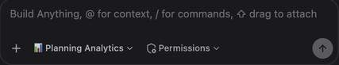
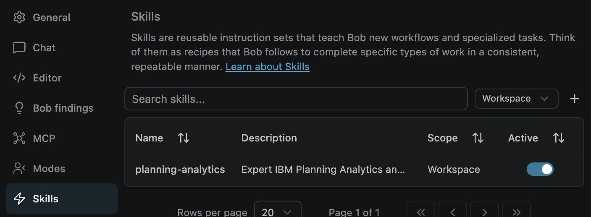
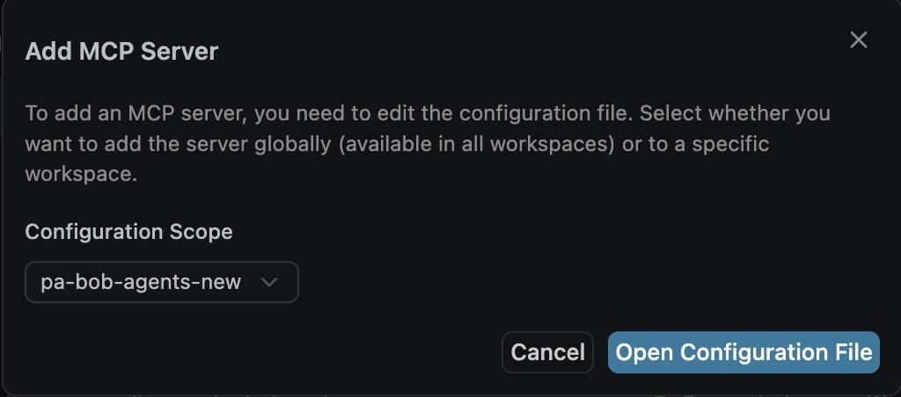
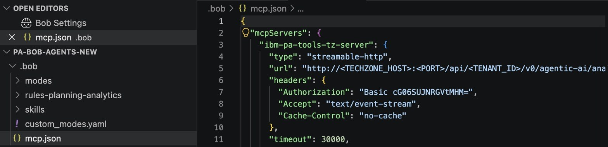
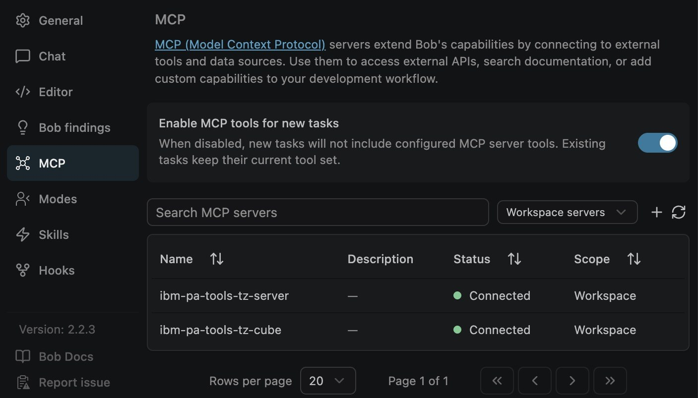
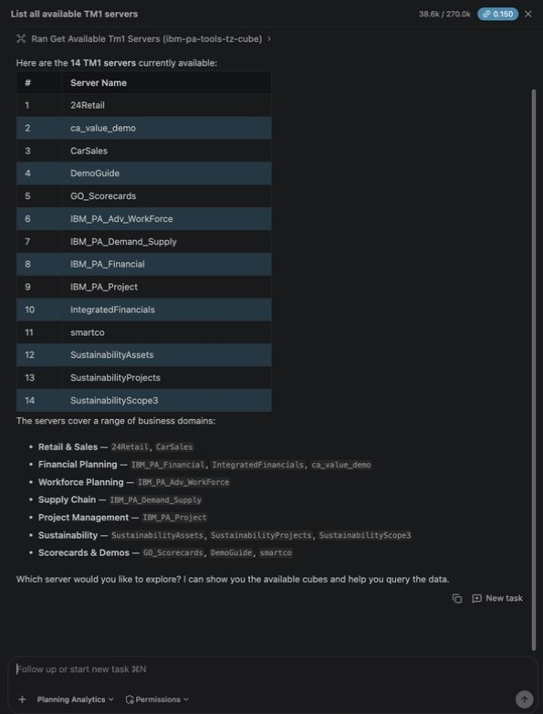

# Lab 0 — Environment Setup

**Duration:** 10–15 minutes

---

## In this lab

> 📍 **Where:** Bob  
> 🎯 **What you do:** Open the workshop folder in Bob, paste your group's Planning Analytics connection, and check that it works.  
> ⚡ **Why it matters:** This is the one-time setup behind every other lab. Once Bob is connected, you can ask Planning Analytics questions, run analyses and change data from the Bob chat, without opening Planning Analytics Workspace or writing MDX.  
> ✅ **You leave with:** Bob connected to your group's Planning Analytics, with the Planning Analytics mode and skill loaded.

---

## Prerequisites

- IBM Bob installed and signed in ([download here](https://bob.ibm.com/download))
- Your group's Planning Analytics link, or your group's ready-made MCP configuration, from your facilitator

> ⚠️ **Planning Analytics version must be 2.1.20** — other versions are not compatible with the MCP tools used in this workshop.

---

## Step 1 — Open the workshop folder in Bob

**Get the folder**, either way:

- With git:
  ```bash
  git clone https://github.com/Austinkkk3/pa-bob-agents-new.git
  ```
- Without git: on the [repo page](https://github.com/Austinkkk3/pa-bob-agents-new), click **Code** → **Download ZIP**, then unzip it. The folder is called `pa-bob-agents-new-main`; that is fine, use it wherever this guide says `pa-bob-agents-new`.

Both give you the same files. A clone can be updated later with `git pull`; with the ZIP, download it again.

**Open it in Bob:** **File** → **Open Folder…** → select the `pa-bob-agents-new` folder (the one that contains `README.md`). On a Mac, Finder hides the `.bob` folder inside it; it is there, and Bob sees it.

Open the whole folder, not a subfolder. The Planning Analytics mode, its rules and the skill are in the `.bob` folder at the top of the repo, and Bob loads them only when that folder is the workspace. Nothing to install or restart.

✅ **Done when:**

- The mode selector under the Bob chat shows **📊 Planning Analytics**. If it shows another mode, click it and pick Planning Analytics.

  

- In the Bob panel, click ⚙ (**Settings**) → **Skills**, and set the filter to **Workspace**: `planning-analytics` is listed and active.

  

---

## Step 2 — Connect Bob to Planning Analytics

MCP (Model Context Protocol) is the bridge that lets Bob call your Planning Analytics TM1 server directly. The connection is a small settings file, `.bob/mcp.json`, in the workshop folder. **You paste it in yourself; about two minutes.** Don't ask Bob to write it for you: the file holds the PA sign-in for a plain `http` address, and Bob may refuse to write that, so the result differs from laptop to laptop.

### 2a. Open the file

In the Bob panel: ⚙ (**Settings**) → **MCP** → **+** → **Configuration Scope**: `pa-bob-agents-new` (or `pa-bob-agents-new-main` if you downloaded the ZIP) → **Open Configuration File**.



Bob creates `.bob/mcp.json` and opens it. It contains only `{ "mcpServers": {} }`.

### 2b. Paste your group's configuration

Select everything in the file (**Cmd+A**, or **Ctrl+A** on Windows) and paste over it:

- **Your facilitator gave you your group's configuration:** paste it as it is and save (**Cmd+S** / **Ctrl+S**). Go to 2c.
- **You only have the Planning Analytics link:** paste the template [`lab-00-setup/mcp.json`](mcp.json), then replace three placeholders, each in **both** `url` lines:

| Placeholder | Where it is in your link | Example |
|-------------|--------------------------|---------|
| `<TECHZONE_HOST>` | Between `http://` and `:` | `xx.services.cloud.techzone.ibm.com` |
| `<PORT>` | The number after `:` | `30123` |
| `<TENANT_ID>` | The `tenantId=` value, **not** `accountId=` | `TENANT123` |

The link looks like `http://xx.services.cloud.techzone.ibm.com:30123/?accountId=ACCOUNT456&tenantId=TENANT123&perspective=pa-home`. Your values are different; the facilitator shows your group's link on screen, or find it on the TechZone reservation page as the Planning Analytics Workspace link.

Leave the `Authorization` lines as they are: `Basic cG06SUJNRGVtMHM=` is the workshop user `pm` / `IBMDem0s`. Then save.



> 💡 Not sure which part is which? Ask Bob to read the link for you, then type the values in yourself:
> ```
> From this Planning Analytics link, give me the HOST, the PORT and the TENANT_ID (the tenantId value, not the accountId): <your link>
> ```

### 2c. Check the connection

Go back to the **Bob Settings** tab → **MCP**, and set the filter to **Workspace servers**. Within a few seconds `ibm-pa-tools-tz-server` and `ibm-pa-tools-tz-cube` show **Connected**. Bob picks up the saved file by itself; no restart is needed. If the list is empty, click ↻ (refresh).



> 🔒 `.bob/mcp.json` is in the repo's `.gitignore`, so your group's address is never committed if you push your copy.

---

## Step 3 — Validate

In **📊 Planning Analytics** mode, start a new task and send:

```
List all available TM1 servers
```

✅ **Done when:** Bob lists 14 servers, including `smartco`.



Listing servers works right away. Queries that read cube data need the Planning Analytics query engine to be warmed up once per environment; your facilitator does this before the session. If your first data query in Lab 1 fails with `409` or "Tool invocation failed", see the last row of Troubleshooting.

---

## Troubleshooting

| Symptom | Fix |
|---------|-----|
| Planning Analytics is not in the mode selector, or the skill is not listed | Bob has a different folder open. **File** → **Open Folder…** → the `pa-bob-agents-new` folder that contains `README.md` and `.bob` |
| The two servers do not appear under **Workspace servers** | The file is not saved, or it is not valid JSON (a quote or comma got lost while pasting). Open `.bob/mcp.json`, look for red underlines, paste again and save |
| A server shows an error or **Disconnected** | Check host, port and tenant ID against your group's link, in both `url` lines, then click ↻. Make sure the PA environment is running: open the link in your browser |
| `401 Unauthorized` | The `Authorization` line changed. It must be `Basic cG06SUJNRGVtMHM=` in both server blocks |
| `smartco` is not in the server list | Bob is connected to a different PA environment. Check the host, port and tenant ID with your facilitator |
| Bob offers to edit `mcp.json` for you, or refuses to | Do it by hand as in Step 2; it is the same two-minute edit on every laptop |
| Data queries fail with `409` or "Tool invocation failed" | Warm up the query engine: open your PA link in the browser, sign in as `pm` / `IBMDem0s` → **Data and Models** → **New workbench** → expand **smartco** → right-click a cube → **Add new view**, wait about 30 seconds, then ask again |

<details>
<summary>Working in a folder of your own instead</summary>

Copy the repo's `.bob` folder (with `custom_modes.yaml`, `rules-planning-analytics` and `skills`) to the top of your folder, then do Step 2 in that folder. Or, to use the connection in every folder, choose **Global (All Workspaces)** as the Configuration Scope in Step 2a: Bob then opens `~/.bob/settings/mcp.json`. If both files define a server with the same name, the workspace file wins.

</details>

---

**→ [Continue to Lab 1](../lab-01-bob-planning-analytics-mcp/README.md)**
