# Lab 1 — Bob + Planning Analytics via MCP

**Duration:** 60 minutes
**Mode:** 📊 Planning Analytics
**Prerequisite:** [Lab 0](../lab-00-setup/README.md) ✅

---

## In this lab

> 📍 **Where:** Bob, 📊 Planning Analytics mode  
> 🎯 **What you do:** Work with Planning Analytics in plain English: explore the model, query it, run a variance analysis, look for outliers, and build a small TM1 model from CSV files.  
> ⚡ **Why it matters:** Questions that normally need a view built in Planning Analytics Workspace or an MDX query take one sentence. In Exercise 5 Bob builds a 6-dimension model and loads 280 rows in about 6.5 minutes; by hand that is an estimated 1–1.5 hours of TM1 development.  
> ✅ **You leave with:** A saved variance view, a PDF exploration report, and your own TM1 model on `DemoGuide`.

## What You Will Do

| Exercise | Task | Time |
|----------|------|------|
| [1](#exercise-1--explore) | Explore servers, cubes, dimensions | 8 min |
| [2](#exercise-2--query) | Query cube data in plain English | 10 min |
| [3](#exercise-3--variance-analysis) | Budget vs Actual variance analysis | 10 min |
| [4](#exercise-4--outlier--impact-analysis) | Outlier detection and key drivers | 10 min |
| [5](#exercise-5--build-a-tm1-model-from-csv) | Build a cube and load data from CSV | 7 min |

Switch to **📊 Planning Analytics** mode before starting.

---

## Step 0 — Warm Up the PA Query Engine (facilitator)

> Your facilitator warms up each group's Planning Analytics before the session, so you can skip this step. Do it yourself only if a query in Exercise 2 fails with `409` or "Tool invocation failed".

On a freshly started TechZone instance the PA grid service (query engine) starts on first use. Until then MDX queries fail, while listing servers and cubes still works. To warm it up:

1. Open your group's PA link in a browser and log in as `pm` / `IBMDem0s`
2. Go to **Data and Models** → **New workbench** → expand **smartco** → right-click any cube → **Add new view**
3. Wait ~30 seconds
4. Return to Bob and ask again

One warm-up per PA environment is enough for the whole group.

---

## Exercise 1 — Explore

**Why:** before you ask questions you need to know what is there. Bob lists servers, cubes and dimensions in seconds, without opening Planning Analytics Workspace.

```
List all available TM1 servers
```
Expected: 14 servers, including `smartco` — the server used throughout this lab. If `smartco` is not in the list at all, Bob is connected to a different Planning Analytics instance: check the host, port and tenant ID in `.bob/mcp.json` with your facilitator.

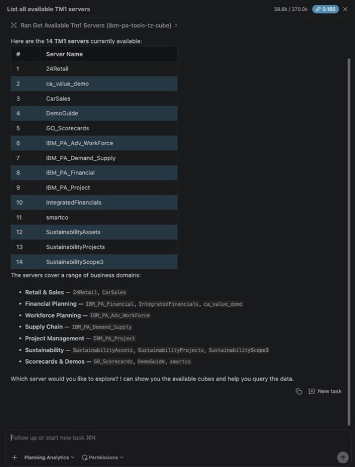

```
Show me all cubes available on the smartco server, including which ones are pre-analyzed
```
Note which cubes show `is_analyzed: true` — these support natural language queries in Exercise 2.

> If you leave out the server name, Bob asks which server to use and offers only a few servers as clickable suggestions. If `smartco` is not one of them, type `smartco` in the reply box.

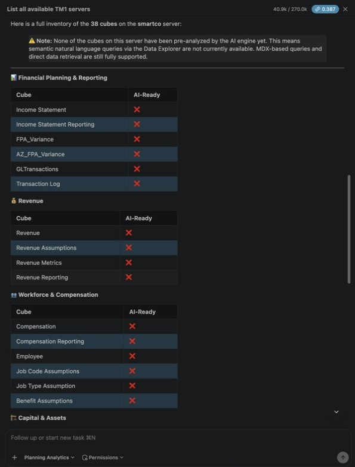

> ℹ️ **Why is nothing pre-analyzed?** A cube is pre-analyzed only after a Planning Analytics administrator has prepared it for natural-language queries. That set-up step has not been run on the workshop instance, so every cube on `smartco`, including `FPA_Variance`, shows `is_analyzed: false`. This is expected and nothing is broken: Bob cannot use the natural-language Data Explorer tool on these cubes, so it writes MDX instead, which works on any cube. All prompts in this lab are written for that case.

```
Show me the dimensions and sample members for the [cube name] cube
```

Use `FPA_Variance` as the cube name. Expected: 6 dimensions — `FPA_Account`, `FPA_Department`, `FPA_Scenario`, `FPA_Time`, `FPA_Version`, `FPA_Measures`.

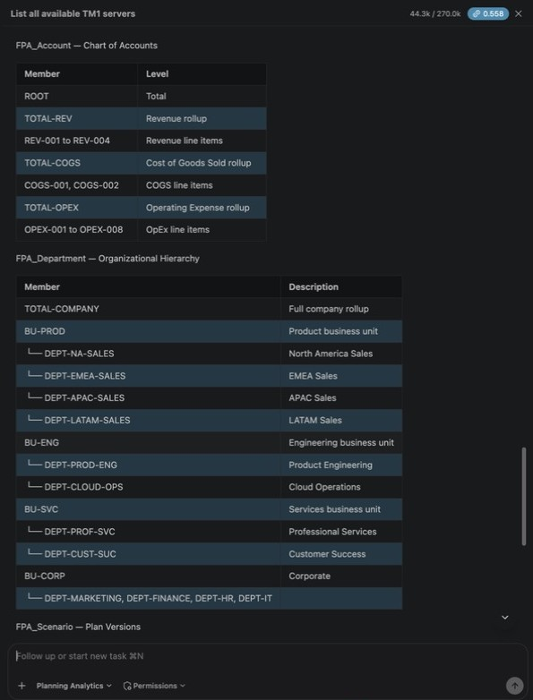

---

## Exercise 2 — Query

**Why:** this is the everyday task, a budget vs actual number. You ask in a sentence and Bob writes the MDX for you.

> Use a pre-analyzed cube from Exercise 1 if there is one. If `FPA_Variance` is **not** pre-analyzed (the default on TechZone), the prompts below still work — Bob falls back to MDX automatically and finds Budget in version V2 and Actual in V1.

```
Show me revenue data for Q1 2024 by department in the FPA_Variance cube on smartco
```

```
Show me budget vs actual revenue for January 2024, broken down by department,
in the FPA_Variance cube on smartco
```

```
Which departments had the largest revenue gap between budget and actual
in the FPA_Variance cube on smartco?
```

Expected for January 2024 total revenue: TOTAL-COMPANY $1,975,000 budget vs $1,828,000 actual (-$147,000, -7.4%); the biggest gap is DEPT-NA-SALES (-$173,000, -25.4%).

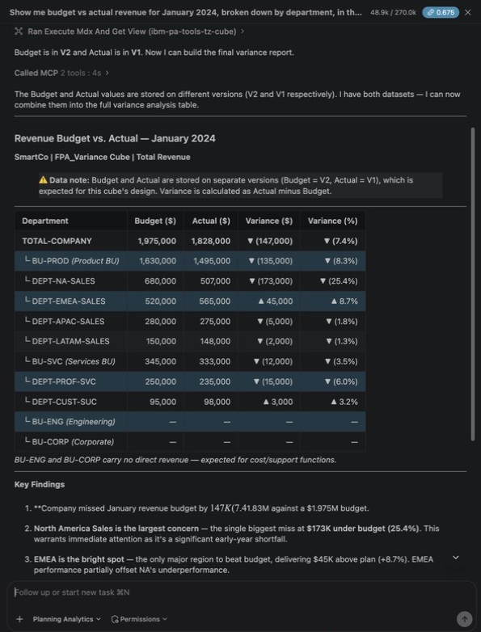

---

## Exercise 3 — Variance Analysis

**Why:** this is the month-end analysis an FP&A analyst does by hand. Bob calculates and ranks the variances, then saves the view so colleagues can open it in Planning Analytics Workspace.

```
Perform a full variance analysis on revenue for January 2024 across all departments
in the FPA_Variance cube on smartco.
Identify all variances greater than $100,000 or greater than 20%, and explain what you find.
```

Expected: only DEPT-NA-SALES crosses the threshold at department level (-$173,000, -25.4%).

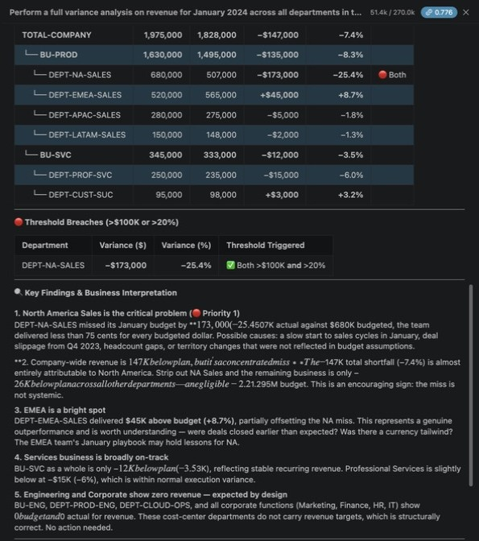

```
Save this variance view as "MY_INITIALS_Jan2024_Revenue_Variance" for future reference
```

> Bob saves it as a **public** view on the shared `FPA_Variance` cube, so use your initials to avoid overwriting someone else's view. The first save attempt may return a connection error — Bob retries automatically.

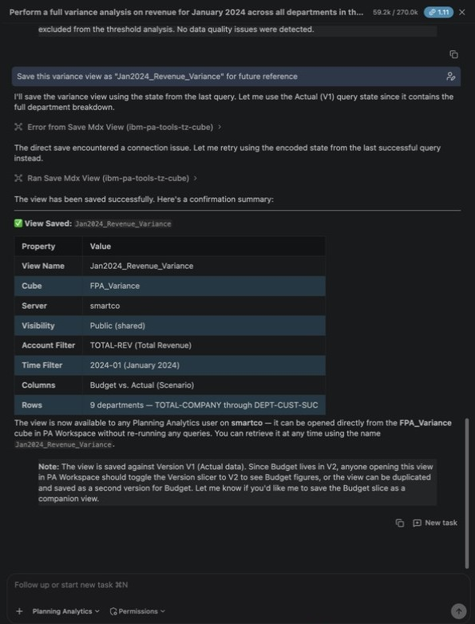

```
Compare January 2024 actual revenue (scenario Actual, version V1, period 2024-01)
with prior-year actual (scenario PY-ACT, version V1, period 2023-01)
for NA Sales, EMEA Sales and APAC Sales, account REV-001,
in the FPA_Variance cube on smartco. Show year-over-year growth rates.
```

> Expected YoY: NA 325K vs 450K (-27.8%); EMEA 420K vs 350K (+20.0%); APAC 275K vs 250K (+10.0%).

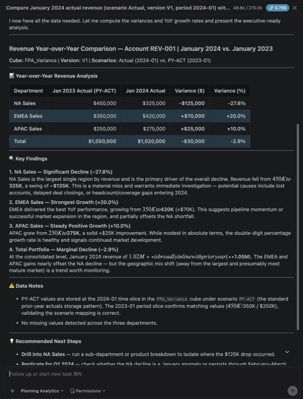

---

## Exercise 4 — Outlier & Impact Analysis

**Why:** unusual numbers are hard to spot across many cells. Bob scans them for you and produces a PDF report you can share, in one request.

> **Set expectations before running:**
> - Outlier detection on 6 departments × 1 month typically returns "no outliers detected" — too few points. Try the wider slice below for better results.
> - `perform_impact_analysis` returns unlabeled x/y scores; the two-tool chain with `get_impact_analysis_summary` may not work. The **PDF report** is the main deliverable for this exercise.

```
Detect statistical outliers in REV-001 revenue for January–June 2024
across all departments in the FPA_Variance cube on smartco.
Explain what you find in business terms.
```

> In testing the outlier detection service returned HTTP 500 and Bob ran the statistics itself from the raw data. The dataset has no April–June actuals for some regions (EMEA April, APAC May–June, LATAM April–June), so Bob flags those zeros as outliers / missing loads — that is expected. NA's January dip and February spike are the real business story.

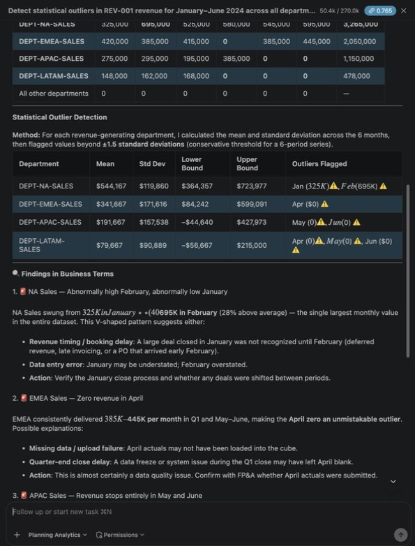

```
What are the key drivers of the revenue variance in January 2024
in the FPA_Variance cube on smartco?
Which factors have the highest impact on the total variance?
```

```
Generate a PDF analysis report for the January 2024 revenue data
in the FPA_Variance cube on smartco
```

> The report is generated on the PA server. It reads a single version (V1), so the **Budget column shows 0** — budget lives in V2. This is expected; do not treat it as missing data.

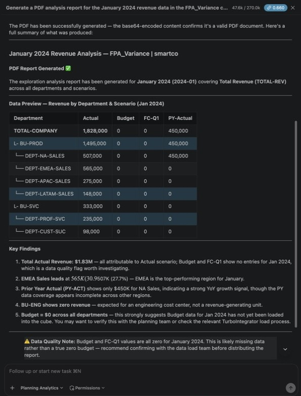

---

## Exercise 5 — Build a TM1 Model from CSV

**Why:** building a model is normally TM1 developer work, mostly TurboIntegrator code. Bob writes, runs and checks the processes: about 6.5 minutes instead of an estimated 1–1.5 hours.

The CSV files are in [`lab-01-bob-planning-analytics-mcp/assets/`](./assets/).

> ⚠️ **Build on the practice server, not on `smartco`.** Lab 2 and Lab 3 depend on the shared `FPA_Variance` cube on `smartco`, so this exercise uses a separate TM1 server on the same PA instance: `DemoGuide` on the TechZone image (your facilitator will tell you if it is different). Use your initials as a prefix so participants don't overwrite each other's objects.

```
Stay in Planning Analytics mode: the PA MCP tools in this workspace can create dimensions, cubes and TI processes.
I have CSV files in the lab-01-bob-planning-analytics-mcp/assets/ folder for an FP&A model.
Read the dimension files (dim_account.csv, dim_department.csv, dim_scenario.csv,
dim_time.csv, dim_version.csv) and the fact file (fact_financial_data.csv).

Create a complete TM1 model on the DemoGuide server using MY_INITIALS as a prefix
(replace MY_INITIALS with your actual initials, e.g. "JD"):
- Create dimensions named MY_INITIALS_FPA_Account, MY_INITIALS_FPA_Department, etc.
- Store descriptive CSV columns as text attributes (not aliases)
- Create a cube called MY_INITIALS_FPA_Variance with those dimensions,
  with FPA_Measures as the last dimension
- The measures dimension must have two members: Amount (Numeric) and RootCause (String)
- Write a TurboIntegrator process to load all 280 fact rows:
  - Use CellPutN for Amount values
  - Use CellPutS for RootCause text where variance_explanation is not empty
- Start the name of every TI process you create with MY_INITIALS_
- Execute the process and confirm the data loaded correctly
- Work only on the DemoGuide server. Do not create, modify or delete anything on smartco or any other server.
```

### ⏱ This step takes 6–7 minutes — here is what Bob is doing

On a clean server the build took about 6.5 minutes and about 9 Bob coins in testing. It is the longest step in the workshop. Bob is not stuck while the screen is quiet; let it finish, and approve any tool call it asks about.

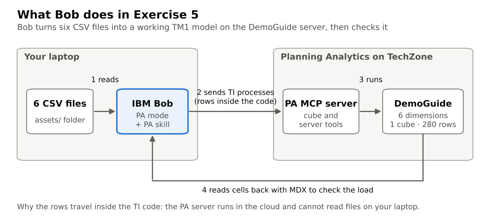

| Stage | What you see in Bob | What happens behind the scenes | Time |
|-------|---------------------|-------------------------------|------|
| 1. Plan | "Used skill planning-analytics", a to-do list | Bob reads the skill and the six CSV files, then plans the build | ~30 s |
| 2. Dimensions | "Create Tm1 Process", "Update Tm1 Process", "Execute Tm1 Processes Asynchronously" | For each of the 6 dimensions, Bob writes a TurboIntegrator (TI) process that creates the members, the roll-ups (such as `TOTAL-REV` and `TOTAL-COMPANY`) and the text attributes, then runs it on `DemoGuide` | 2–3 min |
| 3. Cube | Another TI process | Bob creates `MY_INITIALS_FPA_Variance` with `FPA_Measures` as the last dimension | ~30 s |
| 4. Data load | A long pause, then "Create Tm1 Process" and "Get Tm1 Server Process Status" | Bob writes one TI process with all 280 data rows embedded in its code (`CellPutN` for amounts, `CellPutS` for root-cause text), runs it and checks its status until it finishes. Writing that much code is why the screen looks idle | 1–2 min |
| 5. Check | "Execute Mdx And Get View" | Bob reads a few cells back to confirm the numbers and text match the CSV | ~1 min |

> **Why are the rows inside the TI code?** The Planning Analytics server runs in the cloud and cannot read files on your laptop, so Bob copies the CSV data into the TI process itself instead of using a file data source.

#### Compared with building it by hand

| Task | By hand (estimate, experienced TM1 developer) | With Bob (measured) |
|------|-----------------------------------------------|---------------------|
| Create 6 dimensions with roll-ups and text attributes | 30–45 min | 2–3 min |
| Create the cube | ~5 min | ~30 s |
| Write, run and debug a TI load from CSV (upload the file, map the columns, `CellPutN` / `CellPutS`) | 20–30 min | 1–2 min |
| Spot-check the loaded data | ~10 min | ~1 min |
| **Total** | **about 1–1.5 hours** | **about 6.5 min** |

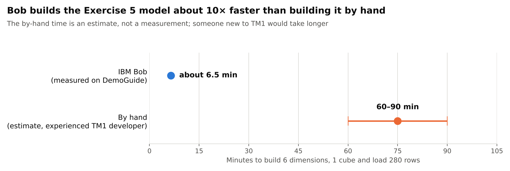

The by-hand times are estimates, not measurements; someone new to TM1 would take considerably longer. What Bob saves most is the TurboIntegrator code: it writes, runs and fixes the processes itself, and the participant only reviews the result.

Bob's summary may say 281 rows; the CSV has 280 data rows, so use the verification query below to confirm the load.

> **Running Exercise 5 a second time?** Use a new prefix (for example `JD2`) or ask Bob to delete your earlier `MY_INITIALS_` objects first. Leftover objects from a previous attempt make Bob work around them (TM1 locks a dimension while a cube uses it), which adds extra processes and can double the build time.

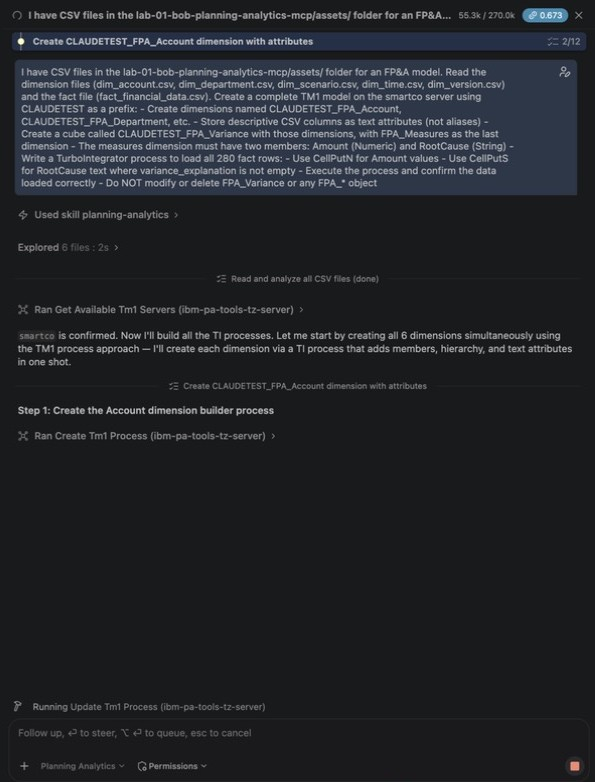

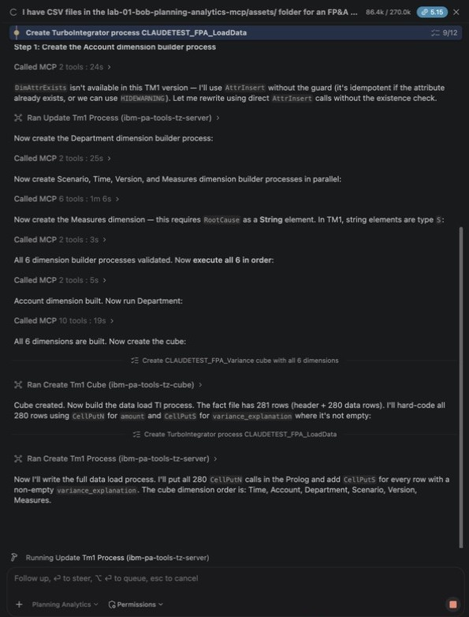

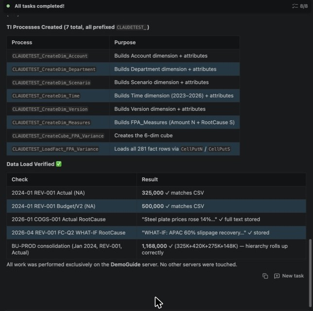

Verify the load:
```
Show me NA Sales actual revenue for Q1 2024 across all accounts
from the MY_INITIALS_FPA_Variance cube on DemoGuide
```

> Expected: REV-001 Q1 = 1,545,000; REV-003 Q1 = 565,000; Total Revenue Q1 = 2,110,000.

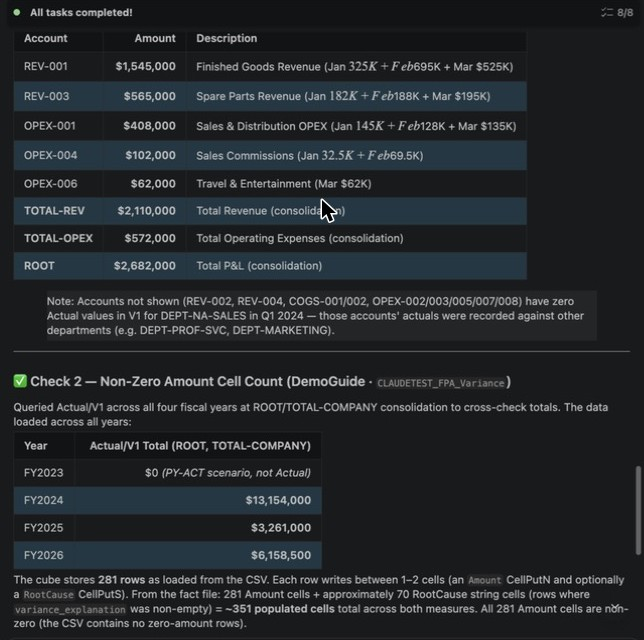

---

## Troubleshooting

| Symptom | Fix |
|---------|-----|
| All cubes show `is_analyzed: false`, or "Cube not pre-analyzed" | Expected — pre-analysis is an administrator set-up step that hasn't been run on the workshop instance. Bob switches to MDX automatically |
| `smartco` is not offered when Bob asks which server to use | Bob only suggests a few servers. Type `smartco` in the reply box, or name the server in the prompt |
| `smartco` is missing from `List all available TM1 servers` | Bob is connected to a different PA instance. Check the host, port and tenant ID in `.bob/mcp.json` |
| `409` error on MDX queries | The PA query engine isn't running yet. Do the Step 0 warm-up in PAW, then retry |
| "Member not found" | Bob calls `lookup_potential_members` and presents options |
| Bob says building cubes or TI processes needs "Advanced mode" | Older copies of the skill say so. Reply `Go ahead in this mode` — Planning Analytics mode has the MCP tools for it. To fix it for good, get the latest workshop folder (`git pull`, or download it again) and open it as in Lab 0 |
| TI process fails | Ask: `Show me the error logs for the last TI process` — Bob explains and fixes |
| Some numbers in Bob's prose appear in italics and run together | Bob renders text between two `$` signs as a math formula. The numbers in the tables are correct |
| Budget shows 0 or "Budget not loaded" | Budget is stored in version V2, Actual in V1. Add "(Actual = scenario Actual, version V1; Budget = scenario Budget, version V2)" to the prompt |

---

**→ [Continue to Lab 2](../lab-02-fpa-variance-autopilot/README.md)**
