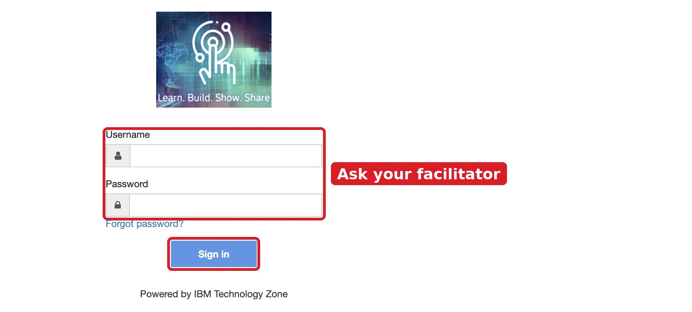
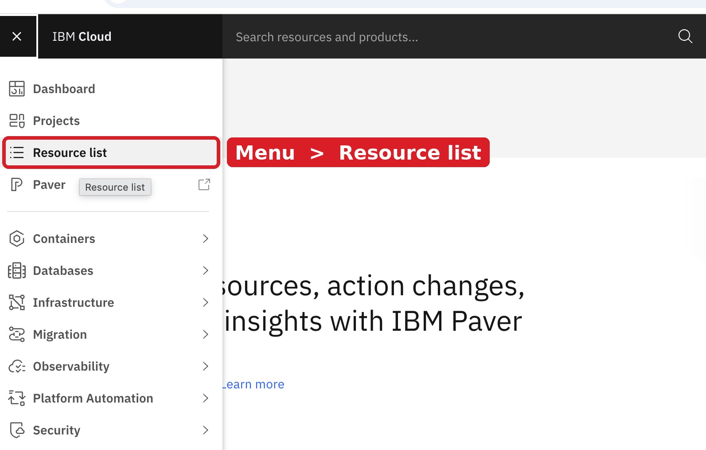
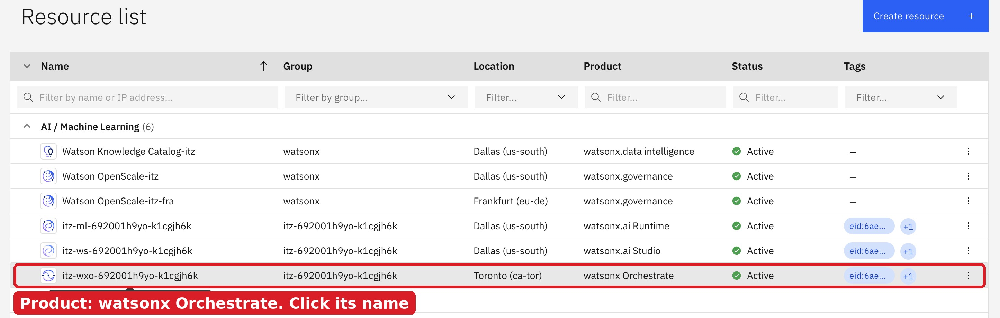
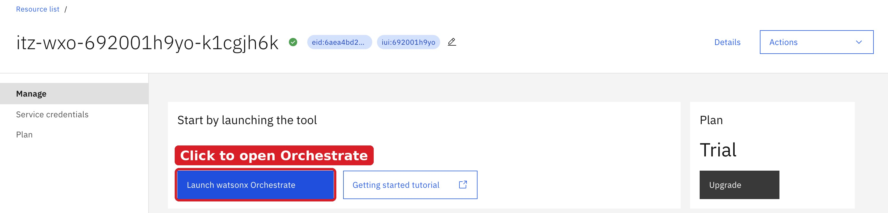
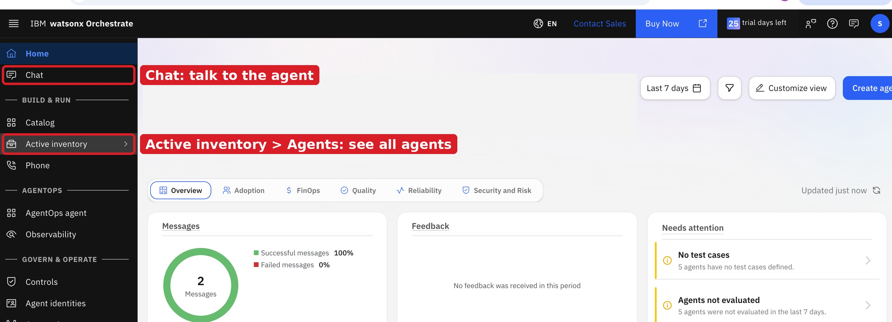
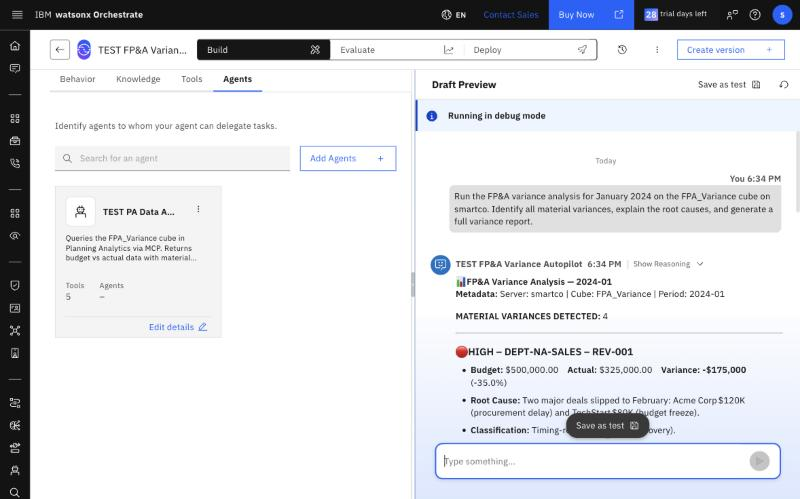
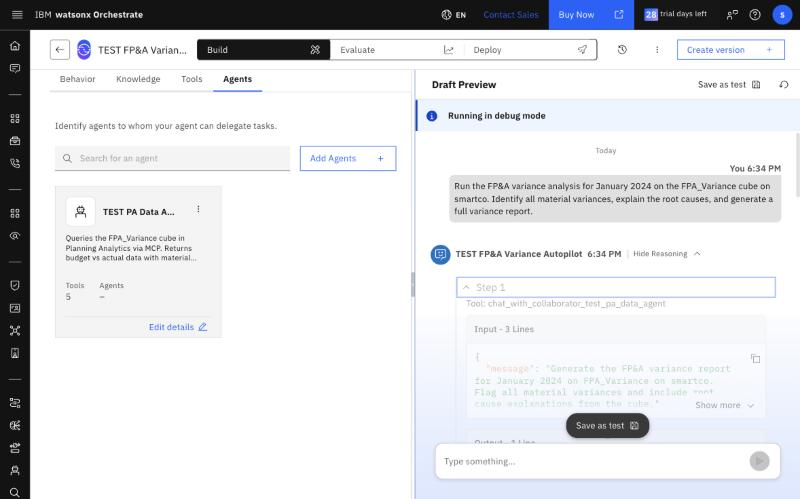
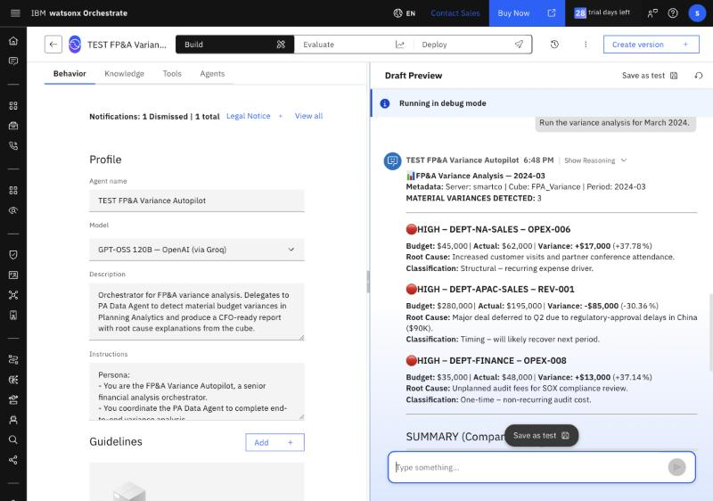

# Lab 2 Ready to Use — Talk to the Pre-built Agents

**For:** everyone; nothing to install beyond Lab 0
**Duration:** ~20 minutes
**Prerequisite:** [Lab 2.0](../lab-02-0-fpa-dataset-catchup/README.md) ✅ · the Orchestrate username and password from your facilitator

> Your facilitator has already built the two Lab 2 agents in the workshop's Orchestrate environment. Everyone in the workshop uses the same agents, so please **do not edit, deploy or delete them**. Want your own copy to change? Take the [Fast Path](../lab-02-fast-path-build-with-bob/README.md).

---

## In this lab

> 📍 **Where:** watsonx Orchestrate → **Chat**, in your browser  
> 🎯 **What you do:** Ask the pre-built FP&A Variance Autopilot for the January 2024 variance report, see how it got there, and ask your own questions.  
> ⚡ **Why it matters:** This is how a business user would use it: no build, no MDX, no spreadsheet. One question returns the variance report with root causes in 1–2 minutes.  
> ✅ **You leave with:** Variance reports for January and March 2024, and a clear picture of what the two agents do behind the answer.

The two agents:

| Agent | What it does |
|-------|--------------|
| **FP&A Variance Autopilot** | The agent you talk to. It hands the data work to the PA Data Agent and writes the report: severity, root cause, timing vs structural, recommended action |
| **PA Data Agent** | Reads the `FPA_Variance` cube on `smartco` through the PA MCP server with 6 read-only tools, and flags material variances with a tested query |

---

## Step 1 — Sign in to the workshop Orchestrate

Both groups use the same Orchestrate and the same sign-in. Ask your facilitator for the username and password.

1. Open **https://cloud.ibm.com/authorize/itzwatsonx9** and sign in with the username and password from your facilitator. This is the IBM Technology Zone sign-in page: your own IBMid doesn't work here.

   

2. IBM Cloud opens. Click the menu icon (☰) at the top left, then **Resource list**.

   

3. Under **AI / Machine Learning**, find the row whose **Product** is **watsonx Orchestrate**. Its name starts with `itz-wxo-`. Click the name.

   

4. Click **Launch watsonx Orchestrate**. You need nothing else on this page.

   

5. Orchestrate opens on its home page. **Chat** is where you talk to the agents (Step 2). To see all agents, open **Active inventory** → **Agents**.

   

6. The agent you use is **FP&A Variance Autopilot**

> Sign-in page says the username or password is wrong? Type them by hand instead of pasting them, and ask your facilitator if it still fails.

---

## Step 2 — Run the variance report

1. ☰ → **Chat**.
2. In the agent list, pick **FP&A Variance Autopilot**, the one with no suffix (see Step 1.6).
3. Send:

```
Run the FP&A variance analysis for January 2024 on the FPA_Variance cube on smartco.
Identify all material variances, explain the root causes, and generate a full variance report.
```

Expect 1–2 minutes. The report lists 4 material variances:

- 🔴 HIGH — DEPT-NA-SALES REV-001: -$175,000 (-35.00%)
- 🔴 HIGH — DEPT-NA-SALES OPEX-001: +$25,000 (+20.83%)
- 🟡 MEDIUM — DEPT-IT OPEX-007: +$14,000 (+18.67%)
- ✅ FAVORABLE — DEPT-NA-SALES OPEX-004: -$17,500 (-35.00%)

Summary: revenue -$147,000 (-7.44%), OpEx +$58,500 (+4.68%). The agent may word the root causes slightly differently; the numbers must match.



---

## Step 3 — See how it got there

Click **Show Reasoning** under the answer. You see one hand-off to the PA Data Agent (`chat_with_collaborator_…`), which runs `execute_mdx_and_get_view` twice: once for the material variances, once for the company totals. The root causes come from the `RootCause` text stored in the cube, the same text you read with Bob in Lab 2.0.



---

## Step 4 — Try your own questions

Start a new chat for each question.

| Prompt | Expected |
|--------|----------|
| `Run the variance analysis for March 2024.` | 3 × 🔴 HIGH: NA Sales OPEX-006 +$17K (+37.78%), APAC REV-001 -$85K (-30.36%), Finance OPEX-008 +$13K (+37.14%). Revenue -$77,000 (-4.18%), OpEx +$33,000 (+4.93%) |
| `Run variance analysis for March 2024 on FPA_Variance on smartco. Focus on APAC Sales.` | 🔴 APAC REV-001 -$85K (-30.4%), root cause: "Major deal pushed to Q2 due to regulatory approval delays in China ($90K)." |
| `Run variance analysis for March 2024 on FPA_Variance on smartco. Focus on Finance department.` | 🔴 Finance OPEX-008 +$13K (+37.1%), root cause: "Unplanned audit fees for SOX compliance review." |
| `List all cubes on smartco.` | Lists about 40 cubes including `FPA_Variance`; no variance analysis is run |



---

## Step 5 — Look under the hood (read only)

The agents are configuration, not code. To see what they are made of without touching the shared agents, read the same definitions in this repo:

- [`pa-data-agent.adk.yaml`](../lab-02-fast-path-build-with-bob/pa-data-agent.adk.yaml): the PA Data Agent's instructions, its tested MDX query and its 6 tools
- [`fpa-orchestrator.adk.yaml`](../lab-02-fast-path-build-with-bob/fpa-orchestrator.adk.yaml): the orchestrator's instructions and its collaborator

In Orchestrate you can also open ☰ → **Active inventory** → **Agents** → an agent, and look at **Behavior** (instructions), **Agents** (collaborators) and **Tools**. Look only: close the page without changing anything.

---

## Next

- **Your own copy to change:** technical participants can build one with Bob in about 20 minutes on the [Fast Path](../lab-02-fast-path-build-with-bob/README.md). Your initials are added to its name, so the shared agents stay untouched.
- **[Lab 3 — Forecast Replan with Bob](../../lab-03-forecast-replan-autopilot/README.md)** *(optional)*: turn the variances into a new forecast written back to Planning Analytics. ⬅️ Lab 3 runs in Bob: switch back to the Bob window and start a new task in 📊 Planning Analytics mode.
- **[Session 3 — Your Scenario](../../session-03-your-scenario/README.md)**: map the autopilot pattern to your own data.

---

## Troubleshooting

| Symptom | Fix |
|---------|-----|
| FP&A Variance Autopilot is not in the Chat list | You are signed in to a different Orchestrate environment (for example your own trial). Use the link from your facilitator |
| The answer takes more than 2 minutes or says "Tool invocation failed" | Several people may be asking at once. Wait a minute and ask again in a new chat |
| `409` error or no data | The Planning Analytics query engine needs a warm-up; tell your facilitator (FACILITATOR-SETUP → Troubleshooting) |
| Different number of variances than expected | Ask in a new chat with the exact prompt above. If it still differs, tell your facilitator: someone may have changed the shared agent, and it can be rebuilt in about 5 minutes |
